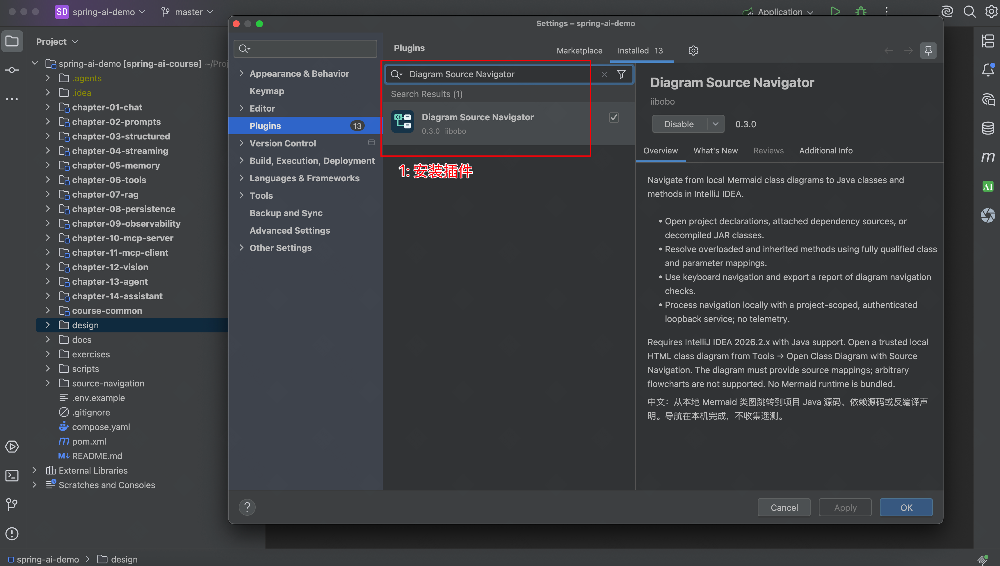
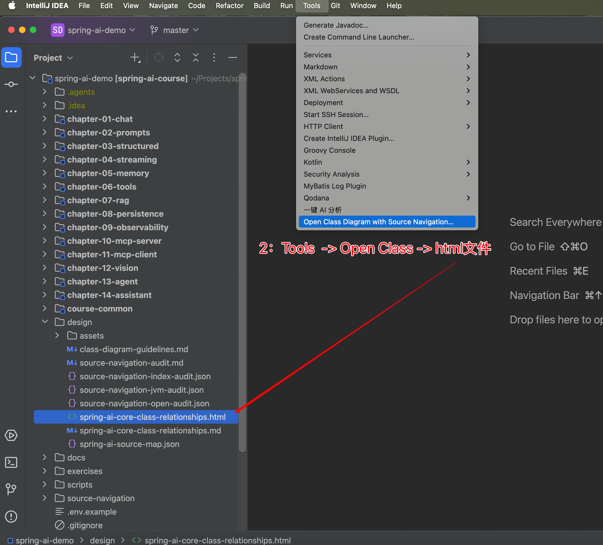
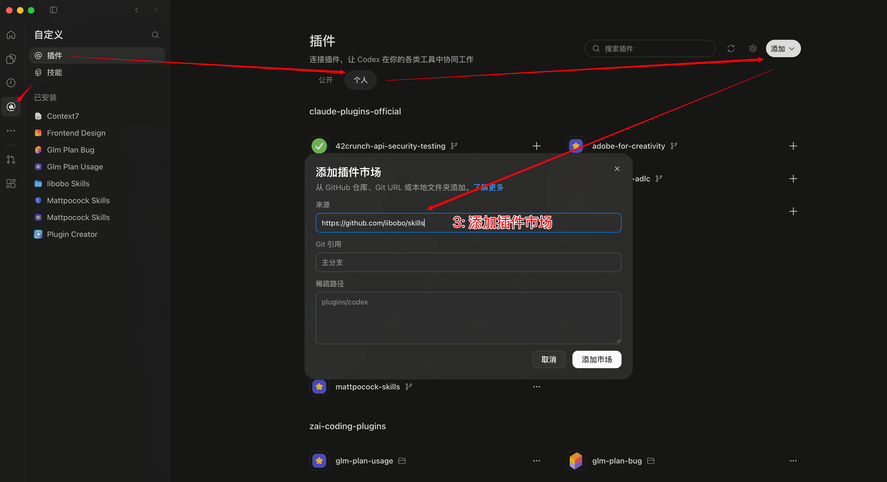

# Diagram Source Navigator

Navigate from local Mermaid class diagrams to Java declarations in IntelliJ IDEA.
Maintained by **iibobo** · [源码与问题反馈](https://github.com/iibobo/diagram-source-navigator)
· **iibobo@zohomail.cn** · [Apache-2.0](LICENSE).

从本地 Mermaid 类图点击 Java 类或方法，在 IntelliJ IDEA 中定位项目源码、依赖 JAR 的关联源码或反编译视图。插件是独立项目，不依赖 Spring AI、原仓库的技能目录、源文件副本或 Maven reactor。

## 时序图兼容

新版浏览器 bridge 同时支持时序图生成器的 `data-source-symbol` / `data-source-method` 链接：从页面 `source-map` 的已校验符号与精确方法签名解析目标，不直接信任元素上的 JSON 目标。顶部和底部参与者、链式方法均可独立定位；“检查全部跳转”也会遍历这些入口。更新插件后通过原 Tools 菜单打开时序图 HTML。普通 localhost 预览只显示使用提示；构建与浏览器模拟测试不代表当前 IDEA 已真实打开每个符号。

## 使用步骤

以下截图按提供的 1 → 4 顺序展示。

### 1. 安装并确认插件

安装并启用 Diagram Source Navigator。



### 2. 在 IDEA 中打开 HTML 类图

点击 IDEA 左下角的 **Diagram Source Navigator** 图标，再点 **Open HTML Diagrams…**。
也可通过 **Tools → Open Class Diagram with Source Navigation…** 打开同一选择框。
按住 Shift 选择一段连续的 HTML 文件，或用 macOS 的 Command（Windows/Linux 的 Ctrl）逐个多选。
确认后，选中的图会分别在浏览器中打开。



### 3. 添加配套技能市场

在 Codex 中添加技能仓库 https://github.com/iibobo/skills，按安装指南安装配套技能。



### 4. 调用技能生成类图

调用绘制类图技能，描述需要梳理的 Java 模块并生成带源码导航信息的 HTML。


## 配套技能

推荐配合 [iibobo skills](https://github.com/iibobo/skills) 中的
[render-class-diagrams](https://github.com/iibobo/skills/blob/main/skills/engineering/render-class-diagrams/SKILL.md)
使用。技能负责根据真实 Java 源码生成带源码定位信息的离线类图，本插件负责在 IDEA 当前项目中打开对应声明。
按[技能安装指南](https://github.com/iibobo/skills/blob/main/docs/installation.md)安装后，可这样提出需求：

> 根据当前 Java 模块源码绘制类与接口关系图，输出可离线打开的 HTML，包含类和方法的源码导航映射。

将生成的 HTML 与相邻 `.assets/` 目录一起保存，在 IDEA 的 **Tools → Open Class Diagram with Source Navigation…**
中选择 HTML，然后点击类名或方法名。其他提供兼容源码映射的可信 HTML 也可使用。

当前 `0.3.0` 为待完成发布验收的候选版本。实际验证结果见
[验证记录](docs/VALIDATION.md)，上架与企业离线部署见 [发布指南](docs/PUBLISHING.md)。
CI 配置、候选 ZIP 或测试源码本身不表示已通过全部生产发布门禁。
本次验收仅覆盖 **macOS**；Windows 和 Linux 尚未完成验收。

## 环境与构建

当前目标：**IntelliJ IDEA 2026.2（build 262）和 Java 25**。其他版本尚未适配，安装包通过 `since-build` / `until-build` 限制版本范围。开发代码使用 Java，与类图涉及的项目 Java 版本无关。

构建只需 Python 3.9+、本机 IDEA 安装目录和 JDK 25+，不下载 Gradle、平台 SDK 或第三方库：

```bash
python3 scripts/build.py --test
# Windows / Linux 或自定义安装目录：
python3 scripts/build.py --idea-home /path/to/idea --java-home /path/to/jdk-25 --test
```

macOS 默认使用 `/Applications/IntelliJ IDEA.app/Contents` 及其自带 JBR；也可设置 `IDEA_HOME`。`JAVA_HOME` 可覆盖编译 JDK。使用 IDEA 自带 Gson，安装包不捆绑平台类库。

输出：`build/distributions/diagram-source-navigator-0.3.0.zip`、对应 `.zip.sha256`
和 `build/build-info.json`。版本唯一来源为 `gradle.properties`；两种构建都会注入插件描述文件。
同源代码、SDK/编译器和压缩工具链下，离线安装包可逐字节复现。

也提供已校验并固定版本的 Gradle wrapper，可以直接用 IDEA 打开本目录导入项目。
设置 `JAVA_HOME` 为 JDK 25 后运行（Windows PowerShell/cmd 使用 `gradlew.bat`）：

```bash
./gradlew check buildPlugin pluginChecksum verifyPlugin -PideaHome=/path/to/idea
./gradlew runIde -PideaHome=/path/to/idea  # 在隔离沙箱中调试插件
node tests/browser/navigation.test.mjs  # 需要 Node.js 22+ 与本机 Chrome
python3 scripts/check_distribution.py build/distributions/diagram-source-navigator-0.3.0.zip
```

本机可在 Git 忽略的 `local.properties` 中设置 `ideaHome=/Applications/IntelliJ IDEA.app/Contents`，
IDEA 自动同步和命令行构建都会复用本机 SDK，无需每次传参。`-PideaHome` 可覆盖该路径；
两处均未设置时（如 CI）才下载 `gradle.properties` 中固定的 IDEA 2026.2.3 SDK；
Gradle 首次需要联网获取构建插件和测试框架。`check` 包括真实 PSI 测试与独立 HTTP runner，
`verifyPlugin` 检查目标 SDK 的二进制兼容性。每次发布应保存实际报告，不能用未执行的任务代替验证。

## 安装与使用

1. IDEA → Settings → Plugins → 齿轮 → Install Plugin from Disk，选择上述 ZIP。按 IDEA 提示重启。
2. 打开需要查源码的 Java 项目，完成 Maven/Gradle 同步。
3. 打开左下角的 **Diagram Source Navigator** 工具窗口，点击 **Open HTML Diagrams…**，或使用 **Tools → Open Class Diagram with Source Navigation…**。可先选择 `examples/diagram.html`，也可用 Cmd（Windows/Linux 用 Ctrl）或 Shift 多选。
4. 每个选中的 HTML 都会在浏览器中单独打开，同一批页面可同时跳转到 IDEA 源码。点击类名或方法名，或按 Tab 选中后按 Enter。出现多个声明时，在页面左下角选择完整签名和依赖位置。

可以直接通过插件打开现有 Spring AI 类图。通过 Tools 菜单或工具窗口打开的页面都会启用源码导航。

成功打开新一批 HTML 后，上一批页面的导航会话随即失效。刷新页面导致配对令牌丢失时，可从插件入口重新打开。关闭项目或卸载插件时会释放当前批次的所有会话。

## 图形与源码映射

支持 Mermaid `classDiagram` 的 `g.node`、类名 `text`、`.methods-group text` 和 `…-classId-Name-N` 节点 ID；不支持任意流程图。插件添加事件代理和悬浮状态提示，不改动节点、方法配色、连线、缩放、导航和全屏控件。

页面可提供内嵌映射，避免同名类歧义：

```html
<script id="source-map" type="application/json">
    {"Worker":{"className":"com.example.Worker"}}
</script>
```

兼容旧映射中的相对 `file`：若对应 Java 文件仍存在于类图目录内，会读取 package 和顶层类型推导完整类名及嵌套接口名；生成器哈希文件名也可使用。没有完整类名映射的节点不启用导航；插件只按全限定类名查询 IDEA 索引。**实际导航始终基于当前项目及其依赖索引**，不打开映射中的源码副本。

方法标签如 `+call(String)` 按名称和擦除后的参数类型匹配；完整参数类型最准确。图中的简化签名通过 `methods` 映射补充真实的 `methodName` 和擦除后的 `parameterTypes`；显式参数不匹配时报告未找到，不回退到其他重载。继承方法定位到真实声明。未找到、索引等待、候选歧义和任务超时会分别提示。未导入的 JAR 不在搜索范围内；源码附件需由 IDEA/Maven/Gradle 关联。

## 实现

- `OpenDiagramAction` 和 `DiagramToolWindowFactory`：提供 Tools 菜单和左下角工具窗口入口，共用 HTML 多选和浏览器打开流程。
- `NavigatorService`：`ReadAction.nonBlocking().inSmartMode()` 在后台解析 PSI，用智能指针把结果传到 UI 线程；`navigationElement` / `Navigatable` 打开声明。重载和同名依赖候选保留真实文件位置。
- `NavigationServer`：随机回环端口、会话令牌、Host/Origin 校验；只提供所选 HTML 及同目录图形资源，不提供目录列表、Java 下载或任意路径执行。
- `navigator-bridge.js`：捕获类/方法点击，提交符号，轮询真实导航完成状态，展示候选；拦截旧 `idea://` 链接。

服务启动后通过 URL fragment 把随机令牌交给页面，页面立即清除地址栏中的 fragment，只在内存持有。HTTP API 需要 Bearer 令牌；不开放 CORS。静态资源限制在所选 HTML 的真实父目录，拒绝越界符号链接及隐藏文件。只选择可信的本地 HTML；它会作为网页运行。
页面中的第三方脚本也能使用其导航权限，HTML 自身仍可能加载外网资源。插件无遥测，
但不会把任意用户 HTML 变成离线或不可信脚本沙箱。最小示例使用固定 SVG，无外网依赖。

接口：`POST /api/navigate` 返回 `202 + requestId`；`GET /api/result/{id}` 返回 pending/opened/ambiguous/not_found 等状态；
`DELETE /api/result/{id}` 取消任务；`GET /api/symbol-map` 返回会话内缓存的规范类名映射。
客户端可通过 `X-Navigator-Request-ID` 提供 UUID，在 POST 响应丢失时仍可取消请求；
DELETE 对未知 UUID 幂等返回 200，并保留两分钟的有界取消记录，防止迟到 POST 再触发导航。
HTML 启动时读取有界快照（最多 32 MiB），映射与页面保持一致。最多保留 128 个未领取任务、
保留 2 分钟，已完成结果领取后释放，单请求体最多 16 KiB；HTTP 请求有 10 秒截止，
导航任务有 90 秒截止，关闭会话时取消未完成任务。接口不支持编辑文件或执行命令。

## 验证

`python3 scripts/build.py --test` 编译全部插件源码，并运行真实本地 HTTP 测试：页面注入、静态资源限制、令牌/来源拒绝、非法请求、请求大小、符号映射、异步完成和符号链接越界。

这些 HTTP 测试注入模拟导航器，**不能代替 IDEA 内的 PSI 集成验收**。
`NavigatorPsiTest` 使用真实 IDEA 测试框架覆盖重载、继承、未找到和打开声明终态；
浏览器测试使用真实 Chrome DOM/网络及受控 HTTP fixture。`.github/workflows/verify.yml`
配置了 macOS 测试及 Plugin Verifier；实际通过状态以 CI 报告为准。
安装后还需检查：

- 在 IDEA 新界面的默认布局中确认左下角显示 Diagram Source Navigator 图标。分别通过工具窗口和 Tools 菜单按住 Shift 选择两个 HTML 文件，确认两个页面都能跳转到源码。将一个非 HTML 文件放在两者之间，确认它不会随范围一起打开。
- 示例中的 `List`、`size()`、`get(int)` 能打开 JDK 声明。
- 当前项目类和依赖 JAR 类均可打开；有/无源码附件分别检查。
- 简化重载签名展示候选，选择后定位；继承方法跳到父类型声明。
- 切换图、全屏和缩放后仍可点击；原图布局保持一致。
- 关闭项目后原页面接口失效。

准备提交 Marketplace 时，按 [发布指南](docs/PUBLISHING.md) 完成签名和首次手动上传。
尚未通过审核的版本不会作为公开 Marketplace 插件供 IDEA 用户搜索安装。
私密安全问题请通过 [安全策略](SECURITY.md) 中的邮箱反馈。

## 全量跳转验收

0.2.4 起，插件页面工具栏提供“检查全部跳转”。它逐张渲染类图，根据真实 SVG 点击目标取得全限定类名和方法签名，在 IDEA 中实际逐项打开声明，结束后恢复原图并提供 JSON 报告下载。该操作会改变 IDEA 当前编辑文件，状态为 `opened` 才计成功；歧义、未映射和未找到单独保留。请先完成 Maven 导入和索引。报告不包含配对令牌。

0.2.4 修复覆写方法与父接口被同时列为候选的问题：优先当前全限定类中的精确签名，只有当前类型没有匹配声明时才搜索继承方法；候选项使用实际声明类。

### macOS 离线核心验收

先在联网环境完成 Gradle 依赖缓存，再运行：

```bash
python3 scripts/verify_offline_macos.py
```

该命令只限制测试进程及其子进程，保留回环通信，拒绝外部 IP 连接，
并强制重跑 PSI 与 HTTP 检查。可通过 `--idea-home /path/to/idea` 指定 SDK。
报告位于 `build/reports/offline/`。浏览器回归会在发送前拦截所有非本地测试地址；
运行 `node tests/browser/navigation.test.mjs` 可复核。此检查不修改系统网络设置。
